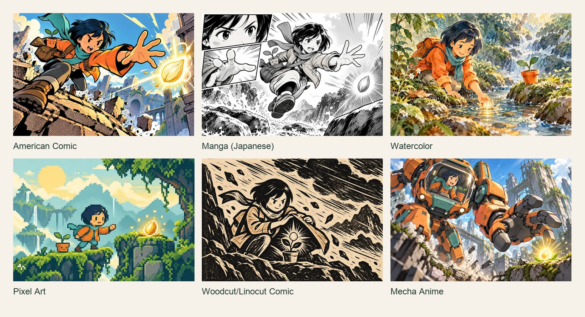
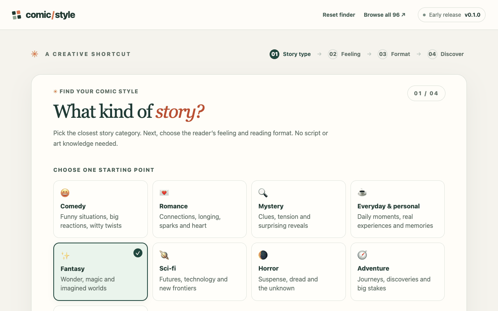

# Comic Style Finder

Find your comic style in 3 questions, then copy a ready-to-use prompt into your favorite AI image tool.

**[Try it live →](https://ai.rockyfu.com/comic-style-finder)**

[](CHANGELOG.md) [](LICENSE) [](#privacy) [](#run-locally)



**Sample images:** AI-generated illustrative samples, free to view and share with attribution to [Comic Style Finder by silentbuilds](https://github.com/silentbuilds/comic-style-finder). These are visual interpretations, not historical exemplars.

## How it works

1. **Choose your story type.** Start with fantasy, everyday moments, comedy or another category. No script needed.
2. **Choose a feeling.** Warm, tense, dreamy, energetic—or let the finder surprise you.
3. **Choose a format.** Pick a carousel, webcomic, page or strip. “Not sure yet” works too.
4. **Discover and copy.** Compare six suggestions, filter or browse all 96 styles, then open a sample and copy its prompt. Advanced lets you edit the visual details or copy just the reusable style block.



## A prompt you can copy

This is the finder’s Watercolor output for Fantasy → Dreamy & wondrous → Classic comic page. Replace the bracketed Story line with your own story before pasting it into an AI image tool.

```text
Story: [Who is it about, where are they, and what happens? 1–3 sentences]

Style: Watercolor. Transparent overlapping washes; layered organic foreground depth; unpainted highlights. Palette: Granulating blue-green shadows with warm accents. Linework: Wet-into-wet edges and restrained dry brush. Texture: Cold-press paper tooth and transparent pigment. Pacing: Lyrical close moments with atmospheric breathing room. Aim for a dreamy and wondrous feeling.

Format: Classic comic page — one 3:4 portrait image with 4–6 panels in a grid and clear white gutters. Apply this layout instead of the sample panel arrangement. Consistency: Keep recurring characters recognizable from panel to panel.
```

The finder selects a style; you write the story in your AI tool. Choose **Copy style only** in Advanced to reuse the visual instructions with another story or format.

## Formats and sizes

Set the size in your image tool before generating. The prompt describes the layout.

| Format | Generate | Then |
| --- | --- | --- |
| Not sure yet | No size or layout specified | Choose a format later |
| Social carousel | 6–8 separate 3:4 portrait slides; keep key content in the centered 4:5 area | Instagram/RedNote: post as is. LinkedIn: crop to 4:5 (1080×1350), then combine into a PDF. Repeat the character description on each slide. |
| Vertical webcomic | One 3:4 portrait image per panel; 9:16 for a tall dramatic panel | Stack panels top to bottom with white gaps |
| Classic comic page | One 3:4 portrait image with 4–6 panels and white gutters | For more control, generate panels separately and assemble |
| Short comic strip | One 16:9 image with 3–4 equal left-to-right panels | For more control, generate panels separately and assemble |

Pages and strips work best with simple scenes. The format you choose takes precedence over the sample’s panel arrangement.

## Privacy

No account, sign-up or API key. Your choices and visual edits stay in this browser, saved locally where browser settings allow. The finder does not collect story text or send your selections to a server.

## Run locally

Open `index.html` in your browser, or serve this folder with `python3 -m http.server 8000`.
For a single file that works offline, download the HTML from the [latest release](https://github.com/silentbuilds/comic-style-finder/releases/latest).

See [Development](docs/DEVELOPMENT.md) for the source layout, build and contributor checks.

## About

[Built by Rocky with AI coding agents](https://rockyfu.com).

## License

[MIT](LICENSE) · Copyright © 2026 silentbuilds.
